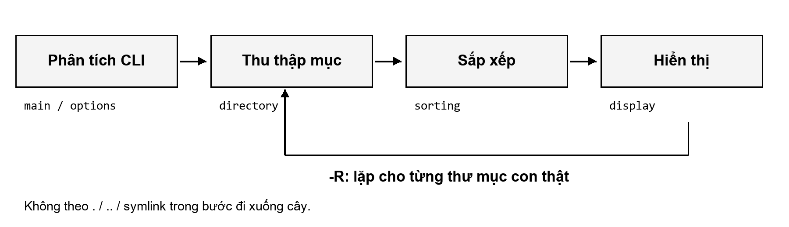

# Tài liệu Kỹ thuật Đọc Tuần tự: Thiết kế và Cài đặt `myls` (`-a`, `-l`, `-R`, `-S`)

Đọc theo thứ tự từ mục 1 đến mục 11: bài toán → kiến thức Linux/C → API → trace chạy → từng cờ → tài nguyên → lỗi → kiểm thử. Cần biết biến, điều kiện và vòng lặp C; các khái niệm con trỏ/struct được giải thích ở mục 3. Muốn chạy ngay, xem [README](../README.md).

---

## Mục lục

1. [Đề tài yêu cầu gì và output mong đợi](#1-đề-tài-yêu-cầu-gì-và-output-mong-đợi)
2. [Kiến thức tối thiểu về file, thư mục, đường dẫn và CLI](#2-kiến-thức-tối-thiểu-về-file-thư-mục-đường-dẫn-và-cli)
3. [Những khái niệm C cần để đọc code: con trỏ, struct, mảng động, ownership, argc/argv, lỗi](#3-những-khái-niệm-c-cần-để-đọc-code-con-trỏ-struct-mảng-động-ownership-argcargv-lỗi)
4. [Directory entry, metadata, hard link và symlink](#4-directory-entry-metadata-hard-link-và-symlink)
5. [Vai trò từng API; phân biệt lệnh shell, hàm thư viện và giao diện system call](#5-vai-trò-từng-api-phân-biệt-lệnh-shell-hàm-thư-viện-và-giao-diện-system-call)
6. [Theo dấu một ví dụ chạy xuyên qua chương trình](#6-theo-dấu-một-ví-dụ-chạy-xuyên-qua-chương-trình)
7. [Giải thích từng cờ và tương tác giữa chúng](#7-giải-thích-từng-cờ-và-tương-tác-giữa-chúng)
8. [Thuật toán, độ phức tạp, bộ nhớ và File Descriptor](#8-thuật-toán-độ-phức-tạp-bộ-nhớ-và-file-descriptor)
9. [Failure paths (Đường lỗi) và Giới hạn](#9-failure-paths-đường-lỗi-và-giới-hạn)
10. [Cách kiểm thử và đọc minh chứng](#10-cách-kiểm-thử-và-đọc-minh-chứng)
11. [Câu hỏi tự kiểm tra, gợi ý trả lời và đường dẫn tới code](#11-câu-hỏi-tự-kiểm-tra-gợi-ý-trả-lời-và-đường-dẫn-tới-code)

---

## 1. Đề tài yêu cầu gì và output mong đợi

1. **Bài toán của Đề tài 17**: Xây dựng chương trình dòng lệnh `./myls` bằng ngôn ngữ C trên hệ điều hành Linux để tái hiện hành vi cốt lõi của lệnh `ls` với bốn tùy chọn: `-a`, `-l`, `-R`, `-S` (cả khi dùng riêng lẻ lẫn khi kết hợp).
2. **Tại sao không được gọi `system("ls")`?**: Hàm `system("ls")` chỉ yêu cầu trình vỏ (shell) khởi chạy chương trình `/bin/ls` có sẵn của hệ điều hành. Cách đó không giúp người học làm việc với thư mục, siêu dữ liệu tệp hay quản lý bộ nhớ hệ thống. Do đó, `myls` phải tự đọc danh mục thư mục, tự lấy thông tin từng mục, tự sắp xếp và tự định dạng kết quả.
3. **Cây thư mục mẫu xuyên suốt (`demo_tree/`)**: Xuyên suốt 11 mục của tài liệu này, ta xét cây thư mục nhỏ sau trên hệ thống tệp Linux:

```text
demo_tree/
├── .config_hidden/       (thư mục ẩn)
│   └── key.conf          (14 bytes)
├── .env                  (tệp ẩn, kích thước 15 bytes)
├── README.txt            (tệp thường, kích thước 512 bytes)
├── notes.txt             (tệp thường, kích thước 512 bytes)
├── database.bin          (tệp thường, kích thước 8192 bytes)
├── link_to_src -> src_module   (symbolic link trỏ tới thư mục src_module, 10 bytes)
└── src_module/           (thư mục con, ví dụ quan sát 4096 bytes trên ext4)
    ├── main.c            (tệp thường có bit SUID 04755, 29 bytes)
    └── loop_parent -> .. (symbolic link trỏ ngược lên thư mục cha, 2 bytes)
```

4. **Output mong đợi trên `demo_tree/`**:
   - Khi chạy `./myls demo_tree`: chỉ in tên các mục không bắt đầu bằng dấu `.`, mỗi mục một dòng, theo thứ tự từ điển byte (`README.txt`, `database.bin`, `link_to_src`, `notes.txt`, `src_module`).
   - Khi chạy `./myls -a demo_tree`: có thêm `.`, `..`, `.config_hidden`, `.env`.
   - Khi chạy `./myls -lS demo_tree`: in dòng `total <1KiB-blocks>`, sau đó in chi tiết từng mục theo kích thước giảm dần (`database.bin` 8192 $\rightarrow$ `src_module` 4096 $\rightarrow$ `README.txt` 512 $\rightarrow$ `notes.txt` 512 $\rightarrow$ `link_to_src -> src_module` 10).
   - Khi chạy `./myls -alRS demo_tree`: liệt kê `demo_tree`, sau đó đi xuống các thư mục thật `.config_hidden` và `src_module` theo size rồi tên; không đi vào `.`, `..`, `link_to_src` hay `loop_parent`.

Các số byte ở đây mô tả fixture demo hiện tại; size thư mục, owner/group, mtime và `total` phụ thuộc môi trường. Chạy `make demo` để tạo cây tương đương trong `/tmp/myls_demo_XXXXXX` và xem đầu ra thật. Script tự xóa fixture sau phiên chạy. Để tự thử từng lệnh mà giữ dữ liệu, đọc khối tạo fixture trong [run_demo.sh](../tests/run_demo.sh), chạy các lệnh tạo trong một thư mục `/tmp` riêng rồi truyền đường dẫn đó cho `myls`. Không dùng thư mục dữ liệu cá nhân cho thử lỗi quyền.

---

## 2. Kiến thức tối thiểu về file, thư mục, đường dẫn và CLI

Để hiểu vì sao `myls` được thiết kế như trong mã nguồn, trước hết cần nắm 4 khái niệm nền tảng của môi trường dòng lệnh Unix/Linux:

1. **Tệp (File) và Thư mục (Directory)**:
   - **Tệp thường (Regular file)**: đối tượng lưu chuỗi byte dữ liệu (văn bản, mã nguồn, ảnh, tệp nhị phân).
   - **Thư mục (Directory)**: đối tượng đặc biệt dùng để tổ chức không gian tên; nội dung của thư mục là danh sách các mục con (gồm tên và mã số tham chiếu).
   - Ngoài ra, hệ thống tệp Unix còn đại diện các tài nguyên khác dưới dạng tệp đặc biệt: **Symbolic link (`l`)**, **Character device (`c`, như `/dev/null`)**, **Block device (`b`, như `/dev/sda`)**, **FIFO/Named pipe (`p`)** và **Unix socket (`s`)**.
2. **Đường dẫn (Path) và nối đường dẫn**:
   - **Đường dẫn tuyệt đối**: bắt đầu từ gốc `/` (ví dụ `/tmp/demo_tree/README.txt`).
   - **Đường dẫn tương đối**: tính từ thư mục làm việc hiện tại của tiến trình (ví dụ `demo_tree/README.txt`).
   - Hai tên đặc biệt có mặt trong mọi thư mục: `.` (trỏ vào chính thư mục hiện tại) và `..` (trỏ lên thư mục cha trực tiếp).
3. **Cấu trúc câu lệnh CLI (Flags vs Operands)**:
   - Trong lệnh `./myls -lS -- demo_tree/README.txt`:
     - `-lS` là các **tùy chọn (options/flags)** điều khiển cách làm việc.
     - `--` là dấu phân cách báo kết thúc phần cờ (mọi tham số đứng sau `--` đều được hiểu là tên đường dẫn, kể cả khi tên tệp bắt đầu bằng dấu `-`).
     - `demo_tree/README.txt` là **toán hạng đường dẫn (path operand)**.
4. **Ba luồng vào/ra chuẩn (`stdin`, `stdout`, `stderr`) và Mã thoát (`exit status`)**:
   - Kết quả danh sách tệp luôn in ra **`stdout`** (File Descriptor `1`).
   - Thông báo lỗi luôn in ra **`stderr`** (File Descriptor `2`) để khi người dùng chuyển hướng `./myls > out.txt`, thông báo lỗi không làm hỏng dữ liệu trong `out.txt`.
   - Khi kết thúc, tiến trình trả về mã thoát nguyên: `0` (thành công), `1` (lỗi mục con trong khi duyệt), hoặc `2` (lỗi đối số CLI, sai cờ, hết bộ nhớ hoặc lỗi ghi `stdout`).

---

## 3. Những khái niệm C cần để đọc code: con trỏ, struct, mảng động, ownership, argc/argv, lỗi

Khi chuyển các khái niệm ở Mục 2 thành mã nguồn C trong [`include/myls.h`](../include/myls.h), chương trình sử dụng 6 cơ chế cốt lõi của ngôn ngữ C:

1. **Nhận tham số dòng lệnh qua `argc` và `argv`**:
   - Hàm `int main(int argc, char *argv[])` trong [`src/main.c`](../src/main.c) nhận số lượng chuỗi `argc` và mảng các con trỏ chuỗi `argv`. Hàm `getopt(argc, argv, "alRS")` trong [`src/options.c`](../src/options.c) quét các cờ và đặt biến toàn cục `optind` trỏ vào vị trí operand đường dẫn đầu tiên.
2. **Gom nhóm dữ liệu bằng `struct`**:
   - [`include/myls.h`](../include/myls.h) định nghĩa 4 kiểu `struct` rõ ràng:
     - `LsOptions`: chứa 4 biến `bool` (`opt_a`, `opt_l`, `opt_R`, `opt_S`).
     - `FileEntry`: chứa thông tin của một mục (`name`, `full_path`, `struct stat st`, `stat_ok`, `link_target`).
     - `EntryList`: quản lý mảng động các `FileEntry` (`items`, `count`, `capacity`).
     - `ColumnWidths`: lưu độ rộng lớn nhất của các cột khi căn lề `-l`.
3. **Con trỏ (Pointers) và truyền địa chỉ để cập nhật trạng thái**:
   - Trong C, tham số truyền theo giá trị. Muốn hàm con cập nhật biến của hàm gọi (như `int *exit_status` hay `EntryList *list`), ta truyền con trỏ tới biến đó.
4. **Mảng động (`malloc` / `realloc`) và kiểm tra tràn số nguyên (`SIZE_MAX`)**:
   - Ta không biết trước một thư mục có 5 tệp hay 100.000 tệp. Vì vậy `EntryList` khởi đầu với sức chứa `64` phần tử và nhân đôi (`capacity * 2`) qua `realloc()` khi đầy.
   - Trước khi nhân `capacity * 2` hoặc `new_cap * sizeof(FileEntry)`, hàm `entry_list_push()` trong [`src/directory.c`](../src/directory.c) kiểm tra `list->capacity > SIZE_MAX / 2` và `new_cap > SIZE_MAX / sizeof(FileEntry)` để ngăn lỗi tràn số nguyên (integer overflow).
5. **Quyền sở hữu bộ nhớ (Memory Ownership)**:
   - Mọi chuỗi được cấp phát trên Heap (`name`, `full_path`, và `link_target` khi mục là symlink ở chế độ `-l`) thuộc quyền sở hữu của `EntryList`.
   - Đích của symbolic link (`char *link_target`) chỉ được cấp phát khi thực sự cần (symlink và bật `-l`); tệp thường giữ `NULL`. So với nhúng mảng 4096 byte trong mọi entry, thiết kế này giảm đáng kể RAM. Với symlink, bộ đệm đọc tạm hiện bắt đầu từ `PATH_MAX`, sau đó chỉ sao chép độ dài chuỗi cần lưu.
   - Khi hàm `entry_list_push()` gặp lỗi cấp phát giữa chừng, nó giải phóng ngay các trường đã cấp phát dở dang của mục đó trước khi trả về `false`. Cuối vòng đời danh sách, `entry_list_free()` giải phóng toàn bộ từng mục và mảng `items`.
6. **Báo lỗi qua `errno` và `strerror(errno)`**:
   - Khi một hàm hệ thống thất bại (trả về `-1` hoặc `NULL`), thư viện C ghi mã lỗi nguyên vào biến `errno` (ví dụ `ENOENT`, `EACCES`, `ENOSPC`). Hàm `strerror(errno)` dịch mã số này thành chuỗi thông báo đọc được.

Các ký hiệu sẽ gặp trong code:

| Ký hiệu | Cách đọc trong dự án |
| --- | --- |
| `&list` | Địa chỉ của biến `list`, cho phép hàm thay đổi chính danh sách đó. |
| `EntryList *p` | `p` chứa địa chỉ một `EntryList`; `p->count` tương đương `(*p).count`. |
| `list.count` | Truy cập trường qua biến struct, không qua con trỏ. |
| `NULL` | Không trỏ tới đối tượng hợp lệ; phải kiểm trước khi dùng. |
| `size_t` / `sizeof(T)` | Kiểu biểu diễn kích thước / số byte của kiểu `T`; dùng khi tính dung lượng mảng. |
| `const char *name` | Hàm đọc chuỗi qua con trỏ này, không sửa nội dung chuỗi bằng con trỏ đó. |
| `static` trước hàm | Hàm chỉ được gọi theo tên trong file `.c` hiện tại; giao diện giữa module nằm ở header. |

Ví dụ vòng đời dưới đây lược bỏ phần đọc thư mục để tập trung vào con trỏ và ownership:

```c
EntryList list;                 /* struct nằm trong khung gọi hiện tại */
entry_list_init(&list);         /* hàm nhận địa chỉ, đặt count/capacity = 0 */
/* entry_list_push(&list, ...) sao chép chuỗi vào heap do list sở hữu */
size_t n = list.count;          /* truy cập qua biến struct */
EntryList *p = &list;
/* p->count cũng đọc chính trường list.count */
entry_list_free(p);             /* giải phóng heap, không free biến stack list */
```

Ký tự `&` còn có nghĩa **AND theo bit** khi nằm giữa hai giá trị, khác với lấy địa chỉ một biến. `(mode & S_IRUSR) != 0` kiểm bit đọc của owner. `S_IRUSR | S_IWUSR` dùng OR để ghép hai mask quyền. Các số bắt đầu bằng `0` như `04755` là bát phân; mỗi chữ số tương ứng một nhóm ba bit. Mục7 áp dụng các phép này để dựng chuỗi quyền.

---

## 4. Directory entry, metadata, hard link và symlink

Đây là nền tảng quan trọng nhất để hiểu vì sao chương trình phải kết hợp `readdir()` với `lstat()`:

1. **Sự tách biệt giữa Danh mục tên (Directory Entry) và Siêu dữ liệu (Inode)**:
   - Trên hệ thống tệp Linux (như ext4), một thư mục thực chất là một danh sách ánh xạ từ **Tên mục (`d_name`)** sang **Số định danh Inode (`d_ino`)**.
   - Trong nhân Linux (Kernel VFS), các ánh xạ đường dẫn được lưu đệm trong *dentry cache*, và siêu dữ liệu gốc nằm trong cấu trúc *inode* của hệ thống tệp.
   - Ở không gian người dùng (User space), khi chương trình gọi `readdir()`, thư viện C trả về con trỏ tới `struct dirent` chứa tên tệp `d_name` và số `d_ino`. **`struct dirent` không chứa kích thước tệp, quyền truy cập, chủ sở hữu hay thời gian sửa đổi.**
2. **Tại sao phải nối đường dẫn rồi gọi `lstat()`?**:
   - Để có quyền, owner/group, size, mtime cho `-l`, size cho `-S` và loại tệp cho `-R`, thiết kế hiện tại dùng `lstat(full_path, &st)` điền `struct stat`. Không dùng riêng `d_type`: trường này không có trên mọi nền tảng và có thể là `DT_UNKNOWN`. Một thiết kế khác có thể dùng `fstatat()` với descriptor thư mục cha.
   - Vì `de->d_name` chỉ là tên cục bộ (ví dụ `"main.c"`), nếu đang duyệt thư mục `"demo_tree/src_module"` mà gọi `lstat("main.c", &st)`, hệ điều hành sẽ tìm `"main.c"` ở thư mục hiện tại `.` và báo lỗi `ENOENT`. Do đó, hàm `join_path()` trong [`src/directory.c`](../src/directory.c) phải ghép `"demo_tree/src_module"` + `"/"` + `"main.c"` thành `"demo_tree/src_module/main.c"` trước khi gọi `lstat()`.
3. **Hard link vs Symbolic link (Symlink)**:
   - **Hard link**: Nhiều tên thư mục cùng trỏ trực tiếp vào **một số Inode duy nhất** trên cùng hệ thống tệp. Trường `st_nlink` trong `struct stat` đếm số tên đang cùng trỏ tới Inode đó.
   - **Symbolic link (Symlink)**: Một tệp đặc biệt (`S_ISLNK`) có Inode riêng; nội dung của nó chỉ lưu chuỗi đường dẫn văn bản trỏ sang mục khác (ví dụ `link_to_src` lưu chuỗi `"src_module"`).
4. **Tại sao mặc định dùng `lstat()` mà chỉ dùng `stat()` ở ngoại lệ CLI?**:
   - Hàm `stat(path, &st)` tự động đi xuyên qua symlink tới mục đích. Nếu symlink bị đứt (trỏ tới tệp không tồn tại), `stat()` báo lỗi `ENOENT`. Nguy hiểm hơn, với `loop_parent -> ..`, nếu dùng `stat()` trong lúc duyệt `-R`, chương trình sẽ thấy đích là thư mục `..` và lặp vô tận.
   - Hàm `lstat(path, &st)` kiểm tra chính bản thân symlink đó (`S_ISLNK(st.st_mode)` là `true`), giúp hiển thị đúng `lrwxrwxrwx ... loop_parent -> ..` và ngăn `-R` đi vào symlink.
   - **Ngoại lệ duy nhất dùng `stat()`**: Khi người dùng truyền trực tiếp một symlink trên dòng lệnh (ví dụ `./myls link_to_src` không kèm `-l`, hoặc `./myls -l link_to_src/` có dấu `/` cuối), chuẩn POSIX quy định phải liệt kê nội dung thư mục đích nếu đích là thư mục. Hàm `should_treat_arg_as_directory()` trong [`src/main.c`](../src/main.c) xử lý chính xác ngoại lệ này.

---

## 5. Vai trò từng API; phân biệt lệnh shell, hàm thư viện và giao diện system call

Trong hệ thống Linux, cần phân biệt rõ 3 tầng:
- **Lệnh shell / tiện ích người dùng**: như `/bin/ls` (chương trình hoàn chỉnh).
- **Giao diện thư viện tới kernel**: chương trình gọi hàm C. `opendir/readdir/closedir` quản lý luồng và bộ đệm thư mục, bên dưới sử dụng syscall; `stat/lstat/readlink` cũng đi qua wrapper của libc. Không có quan hệ bắt buộc một hàm C = một lần syscall. Tên syscall thực tế phụ thuộc kiến trúc và phiên bản libc; muốn quan sát dùng `strace` trên máy đang chạy.
- **Hàm thư viện C**: `getopt`, `qsort`, `strcmp` xử lý dữ liệu ở user space; `printf` có bộ đệm và cuối cùng ghi qua kernel. `getpwuid/getgrgid` có thể truy vấn NSS (tệp cục bộ hoặc dịch vụ), không bảo đảm chỉ xử lý trong RAM.

| Hàm sử dụng | Tầng / Header | Vai trò cụ thể trong `myls` |
| :--- | :--- | :--- |
| `getopt()` | Libc (`<unistd.h>`) | Phân tích cờ `-a`, `-l`, `-R`, `-S` và tách phần cờ khỏi danh sách đường dẫn. |
| `opendir()`, `readdir()`, `closedir()` | Syscall/Libc (`<dirent.h>`) | Mở thư mục, đọc từng `struct dirent` và đóng luồng thư mục để trả lại File Descriptor. |
| `lstat()`, `stat()` | Syscall (`<sys/stat.h>`) | Lấy siêu dữ liệu vào `struct stat` (không đi xuyên symlink với `lstat`, có đi xuyên với `stat`). |
| `readlink()` | Syscall (`<unistd.h>`) | Đọc chuỗi đường dẫn đích của symbolic link (lưu ý `readlink` không tự thêm `'\0'`). |
| `major()`, `minor()` | Macro (`<sys/sysmacros.h>`) | Trích xuất số hiệu thiết bị chính/phụ từ `st_rdev` cho character/block device. |
| `getpwuid()`, `getgrgid()` | Libc (`<pwd.h>`, `<grp.h>`) | Ánh xạ `st_uid` và `st_gid` sang tên người dùng và tên nhóm. |
| `localtime_r()` | Libc (`<time.h>`) | Chuyển `st_mtime` (`time_t`) sang cấu trúc lịch `struct tm` theo múi giờ cục bộ. |
| `qsort()`, `strcmp()` | Libc (`<stdlib.h>`, `<string.h>`) | Sắp xếp mảng động `EntryList` theo kích thước (`-S`) hoặc theo thứ tự byte của tên. |

---

## 6. Theo dấu một ví dụ chạy xuyên qua chương trình

Hãy theo dấu lệnh `./myls -lS demo_tree` đi qua 5 module từ lúc khởi chạy đến lúc thoát:

1. **Bước 1 — Phân tích cờ (`src/options.c`)**:
   - `main()` gọi `parse_options()`. Vòng lặp `getopt(argc, argv, "alRS")` bật `opts.opt_l = true`, `opts.opt_S = true`, các cờ còn lại `false`, và đặt `first_path_idx` trỏ tới `"demo_tree"`.
2. **Bước 2 — Phân loại đối số CLI (`src/main.c`)**:
   - `main()` gọi `lstat("demo_tree", &lst)`. Vì `S_ISDIR(lst.st_mode)` là `true`, `"demo_tree"` được đưa vào `dir_list`.
3. **Bước 3 — Mở và quét thư mục (`src/directory.c`)**:
   - `process_directory("demo_tree", ...)` gọi `opendir("demo_tree")`.
   - Vòng lặp đặt `errno = 0` rồi gọi `readdir(dir)` từng lần. Thứ tự trả về của `readdir()` phụ thuộc cấu trúc nội bộ của hệ thống tệp (ví dụ bảng băm `htree` trên ext4), hoàn toàn chưa được sắp xếp.
   - Vì `opts.opt_a == false`, các mục `.`, `..`, `.env`, `.config_hidden` (có `d_name[0] == '.'`) bị bỏ qua ngay, không tốn lời gọi `lstat()`.
   - Với 5 mục còn lại (`README.txt`, `notes.txt`, `database.bin`, `link_to_src`, `src_module`), chương trình ghép đường dẫn (`"demo_tree/README.txt"`, ...), gọi `lstat()` và (riêng với `link_to_src`) gọi `readlink()` thu được chuỗi `"src_module"`, rồi đẩy vào `EntryList list`.
   - Ngay khi vòng lặp kết thúc, chương trình gọi `closedir(dir)` và kiểm tra lỗi.
4. **Bước 4 — Sắp xếp trong bộ nhớ (`src/sorting.c`)**:
   - `sort_entries(&list, &opts)` gọi `qsort()` với hàm so sánh `cmp_by_size_desc()`.
   - Thứ tự sau khi sắp xếp: `database.bin` (`8192`) $\rightarrow$ `src_module` (`4096`) $\rightarrow$ `README.txt` (`512`) $\rightarrow$ `notes.txt` (`512`, đứng sau `README.txt` do `"README.txt" < "notes.txt"` trong bảng mã ASCII) $\rightarrow$ `link_to_src` (`10`).
5. **Bước 5 — Căn lề hai lượt và kết xuất (`src/display.c`)**:
   - **Lượt 1 (`compute_column_widths`)**: Quét 5 mục để cộng tổng `st_blocks` và tìm độ rộng lớn nhất của cột `nlink`, `owner`, `group`, `size` (lớn nhất là `"8192"` $\rightarrow$ `size_width = 4`).
   - In dòng `total <1KiB-blocks>` tính bằng `(total_blocks_512 + 1) / 2`.
   - **Lượt 2**: Duyệt từng mục, giải mã `st_mode` thành chuỗi 10 ký tự, định dạng thời gian `st_mtime`, và in thẳng hàng bằng định dạng động `%*lu %-*s %-*s %*lld`. Với `link_to_src`, in thêm `" -> src_module"`.
6. **Bước 6 — Dọn bộ nhớ và kiểm tra `stdout` (`src/main.c`)**:
   - Giải phóng `list`, `file_list`, `dir_list`, gọi `flush_and_check_stdout()` và trả về mã thoát `0`.

| Thời điểm trong ví dụ | Trạng thái cần theo dõi |
| --- | --- |
| Sau parse | `opt_l=true`, `opt_S=true`, `opt_a=false`, `opt_R=false`. |
| Trước entry đầu tiên | `count=0`, `capacity=0`; lần push đầu cấp sức chứa 64. |
| Sau thu thập | `count=5`, `capacity=64`; `DIR*` đã đóng, năm entry vẫn còn trên heap. |
| Sau sort | Entry đầu là `database.bin`; hai tệp 512 byte theo thứ tự tên. |
| Trước in | `size_width=4`; owner/group tùy tài khoản Linux đang chạy. |
| Kết thúc | Các chuỗi và mảng được giải phóng; kiểm flush trước khi trả exit. |



Sơ đồ thể hiện luồng điều khiển. Mũi tên quay lại chỉ xảy ra khi bật `-R`; các giá trị trong bảng thuộc fixture minh họa, không phải số đo áp dụng cho mọi thư mục.

---

## 7. Giải thích từng cờ và tương tác giữa chúng

1. **Cờ `-a` (All entries)**:
   - Bỏ bộ lọc `de->d_name[0] == '.'` trong `process_directory()`. Khi đó cả tệp ẩn (`.env`), thư mục ẩn (`.config_hidden`) và hai mục đặc biệt `.`, `..` đều được đưa vào `EntryList`.
2. **Cờ `-l` (Long listing format)**:
   - **Giải mã trường `st_mode` (kiểu `mode_t`)**: Trên Linux, loại tệp và quyền dùng các mask truyền thống ở 16 bit thấp. Mã nguồn dùng `S_IS*` và mask có tên, không giả định `mode_t` luôn rộng16bit:
     - Phần mặt nạ loại tệp `S_IFMT` (`0170000`): xác định ký tự đầu (`-`, `d`, `l`, `c`, `b`, `p`, `s`).
     - 9 bit quyền cơ bản (`S_IRUSR`..`S_IXOTH`): tạo ra 3 cụm `rwx` cho User, Group, Others.
     - 3 bit đặc biệt:
       - `S_ISUID` (`04000`): đổi vị trí `x` của User (ký tự thứ 3) thành `'s'` nếu có quyền `x`, hoặc `'S'` nếu không có quyền `x`.
       - `S_ISGID` (`02000`): đổi vị trí `x` của Group (ký tự thứ 6) thành `'s'` hoặc `'S'`.
       - `S_ISVTX` (`01000`, Sticky bit): đổi vị trí `x` của Others (ký tự thứ 9) thành `'t'` hoặc `'T'`.
   - **Hiển thị thiết bị (`c` và `b`)**: Nếu mục là character device hoặc block device, thay vì in `st_size`, chương trình in `major(st_rdev), minor(st_rdev)` (ví dụ `1, 3` cho `/dev/null`) và tự động đồng bộ độ rộng cột với các tệp thường cùng danh sách.
   - **Quy tắc thời gian 6 tháng**: Nếu `st_mtime <= now` và `now - st_mtime < 15778476` giây (~6 tháng), in `"Tháng Ngày Giờ:Phút"`; ngược lại (tệp cũ hơn 6 tháng hoặc timestamp trong tương lai), in `"Tháng Ngày  Năm"`.
3. **Cờ `-S` (Sort by size descending)**:
   - So sánh `a->st.st_size` và `b->st.st_size` bằng `>` và `<` (trả `-1` hoặc `1`). `off_t` là 64 bit trên môi trường x86_64 đã thử, còn giá trị comparator trả về là `int`. Trừ hai size rồi ép sang `int` có thể làm mất thông tin hoặc đảo dấu; so sánh trực tiếp tránh vấn đề đó.
   - Khi hai mục có cùng `st_size`, dùng `strcmp(a->name, b->name)` để phân định thứ tự tăng dần theo tên.
4. **Cờ `-R` (Recursive) và tương tác với `-a`, `-S`, `-l`**:
   - Khi kết hợp `-alRS`:
     - Nhờ `-a`, các thư mục ẩn như `.config_hidden` được thu thập vào `list`, nhờ đó `-R` sẽ đi vào duyệt cả các thư mục ẩn này.
     - Nhưng nhờ hàm `is_recursible_subdir()`, hai mục `.` và `..` (dù được hiển thị do `-a`) cùng mọi symbolic link (`!S_ISDIR(e->st.st_mode)` do dùng `lstat()`) đều bị chặn không cho đệ quy.
     - Nhờ gọi `sort_entries()` trước vòng lặp đệ quy, thứ tự duyệt các thư mục con trong `-R` cũng tuân theo đúng thứ tự của `-S` (hoặc tên từ điển nếu không bật `-S`).

---

## 8. Thuật toán, độ phức tạp, bộ nhớ và File Descriptor

1. **Độ phức tạp thời gian (Time Complexity)**:
   - Với một thư mục có $N$ mục:
     - Thu thập và gọi `lstat()`: $\mathcal{O}(N)$ lời gọi hệ thống.
     - Sắp xếp bằng `qsort()`: thường phân tích là $\mathcal{O}(N \log N)$ phép so sánh với triển khai đang dùng; chuẩn C không cam kết thuật toán hoặc độ phức tạp cụ thể. So sánh chuỗi còn phụ thuộc độ dài tiền tố chung.
     - Tính độ rộng cột và in ra màn hình: $2 \times \mathcal{O}(N) = \mathcal{O}(N)$.
   - Mô hình thường dùng cho một thư mục là $\mathcal{O}(N \log N)$, chưa tính độ dài đường dẫn/tên, độ trễ I/O và tra cứu NSS. Đây là phân tích, không phải kết quả benchmark.
2. **Đánh đổi giữa File Descriptor (FD) và Bộ nhớ khi đệ quy `-R`**:
   - Tiến trình có giới hạn descriptor (`RLIMIT_NOFILE`); kiểm máy đang chạy bằng `ulimit -n`, không cố định mọi máy là 1024.
   - Trong `process_directory()`, chương trình đọc hết các mục của thư mục hiện tại vào `EntryList list` rồi gọi `closedir(dir)` **trước khi** gọi đệ quy xuống thư mục con. Nhờ vậy, tại mọi thời điểm chỉ có tối đa **1 directory stream (1 FD)** đang mở cho việc duyệt cây thư mục, bất kể cây sâu bao nhiêu tầng.
   - **Đánh đổi về bộ nhớ (Memory Trade-off)**: Vì cuộc gọi đệ quy diễn ra bên trong vòng lặp duyệt `list` của thư mục cha (trước dòng `entry_list_free(&list)`), các `EntryList` của những thư mục tổ tiên trên nhánh đệ quy hiện tại vẫn còn tồn tại trong RAM cho tới khi nhánh con đó duyệt xong. Cụ thể, nếu cây sâu $D$ mức thì bộ nhớ đang giữ đồng thời bằng tổng kích thước các `EntryList` dọc theo đường đi từ gốc đến nút lá hiện tại ($\sum_{k=1}^{D} N_k$), chứ không chỉ riêng thư mục đang in. Việc chỉ cấp phát động `link_target` khi cần thiết giúp giảm đáng kể chi phí bộ nhớ trên mỗi phần tử của các danh sách này.

---

## 9. Failure paths (Đường lỗi) và Giới hạn

### 9.1. Bảng xử lý các đường lỗi (Failure paths)

| Tình huống lỗi | Nơi phát hiện | Phản ứng của chương trình | Mã thoát |
| :--- | :--- | :--- | :--- |
| Cờ dòng lệnh không hợp lệ (ví dụ `-z`) | `parse_options()` | In thông báo lỗi và hướng dẫn ra `stderr`, dừng ngay. | `2` |
| Đối số đường dẫn trên CLI không tồn tại | `main()` (`lstat`) | In `cannot access ...` ra `stderr`, tiếp tục xử lý các đối số CLI còn lại. | `2` |
| Thư mục truyền trực tiếp trên CLI không có quyền đọc | `process_directory()` (`is_cli_operand=true`) | In `cannot open directory ...` ra `stderr`, tiếp tục các đối số còn lại. | `2` |
| Thư mục con gặp trong quá trình đệ quy `-R` không có quyền đọc | `process_directory()` (`is_cli_operand=false`) | In `cannot open directory ...` ra `stderr`, tiếp tục duyệt các nhánh khác. | `1` |
| Lỗi `lstat()`, `readdir()`, `readlink()`, `closedir()` trên mục con | `directory.c` | In chẩn đoán lỗi ra `stderr`; với `readlink()` vẫn hiển thị phần metadata đọc được từ `lstat()`. | `1` (hoặc `2` nếu là CLI operand) |
| Hết bộ nhớ (`malloc`/`realloc` thất bại hoặc tràn `SIZE_MAX`) | `directory.c` | Giải phóng các trường cấp phát dở dang, đóng `DIR*`, báo `stderr`. | `2` |
| Lỗi ghi `stdout` (ví dụ đầy ổ đĩa `/dev/full`) | `display.c` / `main.c` (`fflush`/`ferror`) | Phát hiện khi ghi hoặc khi flush cuối chương trình, báo `write error` ra `stderr`. | `2` |

Hàm `elevate_status(&exit_status, new_code)` đảm bảo khi có nhiều lỗi xảy ra trong cùng một lần chạy, mã thoát luôn giữ mức nghiêm trọng cao nhất (`2` không bao giờ bị hạ xuống `1`).

### 9.2. Phạm vi hỗ trợ và các giới hạn được ghi nhận rõ

1. **Định dạng đầu ra khi không có `-l`**: Luôn in một mục trên mỗi dòng; không cài đặt chế độ chia nhiều cột theo độ rộng terminal (`ioctl(TIOCGWINSZ)`) hay tô màu ANSI.
2. **Quy tắc sắp xếp tên**: So sánh theo giá trị byte bằng `strcmp()` (tương đương `LC_ALL=C`); không cài đặt quy tắc sắp xếp ngôn ngữ bản địa (`strcoll`) hay định dạng dấu phẩy động của GNU.
3. **Đơn vị khối `total`**: Cố định theo đơn vị 1 KiB (`(total_blocks_512 + 1) / 2`), không phụ thuộc các biến môi trường `BLOCK_SIZE` hay `POSIXLY_CORRECT` của GNU.
4. **Siêu dữ liệu mở rộng và tình huống hệ thống phức tạp**: Không truy vấn ACL (`+`) hay ngữ cảnh SELinux (`.`); tên tệp được in nguyên bản (literal), không escape ký tự điều khiển; chưa xử lý phát hiện chu trình mount point (bind mount loops) hoặc cây thư mục bị tiến trình khác thay đổi đồng thời trong lúc đang quét.

---

## 10. Cách kiểm thử và đọc minh chứng

1. **Tại sao phải đặt cây dữ liệu kiểm thử trên `/tmp` của WSL2 thay vì `/mnt/p`?**:
   - Quyền trên ổ Windows của WSL phụ thuộc quyền Windows, DrvFs mount options và chế độ `metadata`. Không thể kết luận mọi tệp luôn là 0777. `chmod` và các loại tệp đặc biệt có thể khác hành vi filesystem Linux; xem [Microsoft Learn](https://learn.microsoft.com/en-us/windows/wsl/file-permissions).
   - Ngược lại, `/tmp` nằm trên hệ thống tệp gốc của nhân Linux trong máy ảo WSL2, hỗ trợ đầy đủ quyền `rwx`, SUID/SGID/Sticky, hard link, symlink, FIFO và Unix socket.
2. **Cách tổ chức bộ kiểm thử (`tests/run_tests.sh`)**:
   - Tự động biên dịch unit test nội bộ (`build/test_internals`) và thư viện tiêm lỗi (`build/fault_inject.so`), khởi tạo cây fixture trên `/tmp` và tự dọn sạch qua `trap cleanup EXIT`.
   - 26 ca đầu đối chiếu `LC_ALL=C TZ=UTC0 ls -N`: nội dung stdout (`diff -u`), mã thoát và không có stderr bất thường.11 ca sau kiểm helper nội bộ và hợp đồng lỗi, không đều là differential test.
   - Chạy cùng một bộ 37 kịch bản trên cả bản biên dịch thường (`make test`) và bản gắn bộ dò lỗi bộ nhớ (`make sanitize` với `-fsanitize=address,undefined`).
3. **Cách đọc các tệp minh chứng trong `evidence/`**:
   - [`evidence/test_suite_report.txt`](../evidence/test_suite_report.txt): Log gốc của `make test` kèm thông tin phiên bản compiler, kernel, Git revision và kết quả từng kịch bản.
   - [`evidence/memory_sanitizer_report.txt`](../evidence/memory_sanitizer_report.txt): Log chạy `make sanitize` chứng minh không phát hiện lỗi bộ nhớ hay hành vi bất định trên toàn bộ các kịch bản đã chạy.
   - [`evidence/demo_session_output.txt`](../evidence/demo_session_output.txt): Log chạy `make demo` trên cây fixture cô lập.
   - [`evidence/test_results.json`](../evidence/test_results.json): Dữ liệu từng ca và demo, kèm hash source/tests/Makefile. Builder từ chối hash cũ, lỗi hoặc thiếu summary. PASS/FAIL/SKIP phải đọc đúng cả ba, không biến SKIP thành PASS. Ảnh là trích log để đọc, không phải ảnh chụp terminal.

---

## 11. Câu hỏi tự kiểm tra, gợi ý trả lời và đường dẫn tới code

1. **Câu hỏi 1**: *Tại sao trong `process_directory()` phải gọi `lstat()` mà không dùng `stat()`?*
   - **Gợi ý trả lời**: `lstat()` đọc siêu dữ liệu của chính symbolic link thay vì đi xuyên tới đích. Nhờ đó chương trình hiển thị được cả broken symlink và ngăn `-R` đi nhầm vào symlink trỏ ngược lên thư mục cha gây lặp vô tận.
   - **Vị trí trong code**: [`src/directory.c`](../src/directory.c) (hàm `populate_file_entry` và `is_recursible_subdir`).
2. **Câu hỏi 2**: *Khi nào chương trình cần gọi `stat()`?*
   - **Gợi ý trả lời**: Chỉ ở bước phân loại đối số truyền trực tiếp trên dòng lệnh (`CLI operand`): nếu đối số là symlink trỏ tới thư mục và người dùng không bật `-l` (hoặc viết kèm dấu `/` ở cuối như `symlink_to_dir/`), chương trình gọi `stat()` để kiểm tra đích có phải thư mục hay không nhằm liệt kê nội dung thư mục đó.
   - **Vị trí trong code**: [`src/main.c`](../src/main.c) (hàm `should_treat_arg_as_directory`).
3. **Câu hỏi 3**: *Tại sao hàm `readdir()` yêu cầu đặt `errno = 0` ngay trước mỗi lần gọi?*
   - **Gợi ý trả lời**: `readdir()` trả về `NULL` trong cả hai trường hợp: khi đã đọc hết thư mục (EOF) và khi xảy ra lỗi I/O. Khi chạm EOF, `readdir()` không thay đổi `errno`. Đặt `errno = 0` trước khi gọi giúp kiểm tra chính xác `if (de == NULL && errno != 0)` để biết có lỗi đọc thư mục thật hay không.
   - **Vị trí trong code**: [`src/directory.c`](../src/directory.c) (vòng lặp `for (;;)` trong `process_directory`).
4. **Câu hỏi 4**: *Tại sao trong chế độ `-l` chương trình không in từng mục ngay khi vừa đọc xong từ `readdir()`?*
   - **Gợi ý trả lời**: Có 3 lý do: (1) Thứ tự từ `readdir()` chưa được sắp xếp theo tên hay theo `-S`; (2) Dòng `total <1KiB-blocks>` phải in ở đầu thư mục nhưng chỉ tính được sau khi đã cộng `st_blocks` của mọi mục; (3) Độ rộng các cột (`nlink`, `owner`, `group`, `size`) phụ thuộc vào phần tử dài nhất trong toàn thư mục.
   - **Vị trí trong code**: [`src/display.c`](../src/display.c) (hàm `compute_column_widths` và `display_entries`).
5. **Câu hỏi 5**: *Tại sao mã thoát khi truyền đường dẫn không tồn tại trên CLI là `2`, trong khi thư mục con không đọc được trong quá trình duyệt `-R` lại trả về `1`?*
   - **Gợi ý trả lời**: Theo quy ước của GNU `ls` và hợp đồng hành vi của chương trình, lỗi không truy cập được toán hạng do người dùng chỉ định trực tiếp trên CLI là lỗi nghiêm trọng (`EXIT_LS_SERIOUS_ERR = 2`), còn lỗi phát sinh ở một nhánh thư mục con trong quá trình quét cây là lỗi cục bộ (`EXIT_LS_MINOR_ERR = 1`).
   - **Vị trí trong code**: [`include/myls.h`](../include/myls.h), [`src/main.c`](../src/main.c) và [`src/directory.c`](../src/directory.c).

## Nguồn đối chiếu

- [GNU Coreutils — ls](https://www.gnu.org/software/coreutils/manual/html_node/ls-invocation.html): hành vi tham chiếu; `myls` chỉ hỗ trợ hợp đồng ở mục 1/9.
- [readdir(3)](https://man7.org/linux/man-pages/man3/readdir.3.html): bộ đệm trả về, `DT_UNKNOWN`, EOF và `errno`.
- [stat(2)](https://man7.org/linux/man-pages/man2/stat.2.html), [readlink(2)](https://man7.org/linux/man-pages/man2/readlink.2.html): metadata, symlink và chuỗi đích.
- Mã nguồn repo là căn cứ cho cách cài đặt hiện tại. Kết quả thử nghiệm nằm ở `evidence/`; cách tái tạo nằm trong [MAINTENANCE](MAINTENANCE.md).
